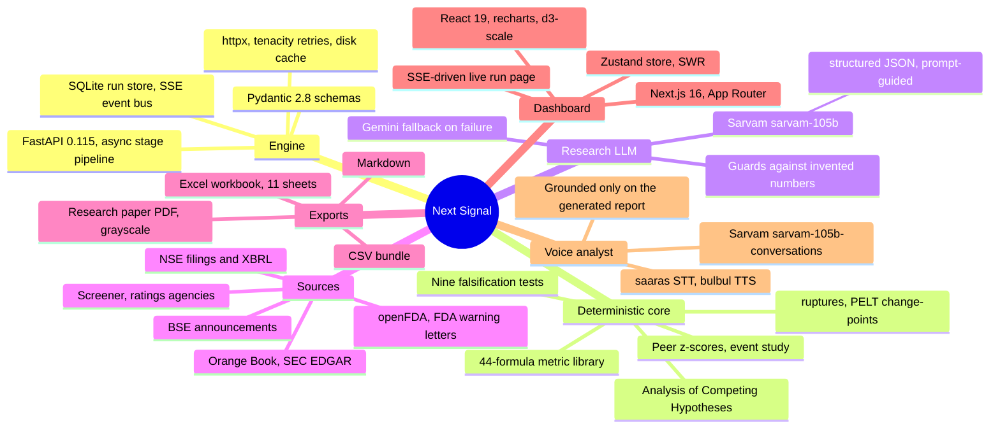
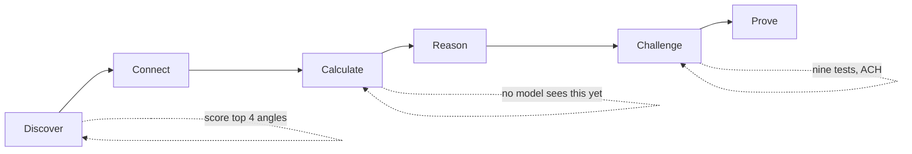
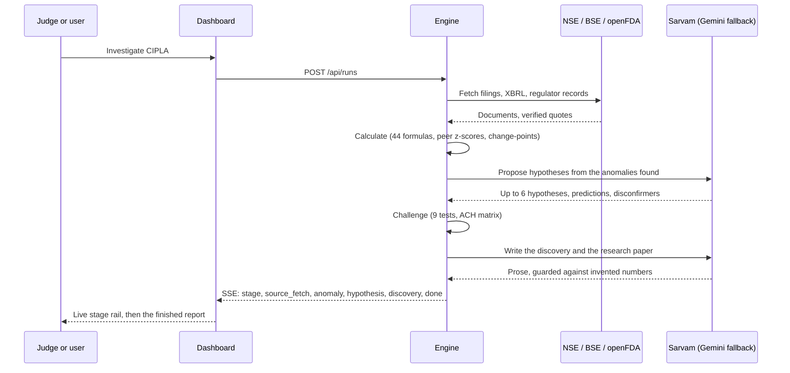

<div align="center">

# Next Signal

*An agent that computes before it reads, checks outside the company before it trusts the company, and spends most of its effort trying to prove itself wrong.*


[The problem](#the-problem) &middot; [A map of the stack](#a-map-of-the-stack) &middot; [What the system decides, what a model proposes](#what-the-system-decides-what-a-model-proposes) &middot; [The six stages](#the-six-stages-how-a-run-actually-moves) &middot; [Running it locally](#running-it-locally) &middot; [Known limitations](#known-limitations)

</div>

---

## The problem

Built for "Finding the Next Signal" (ATMOS 2026, BITS Pilani Hyderabad Campus, The Wall Street Club and The
Economics Association, Track D: Pharma and Healthcare). The brief does not hand over a dataset or an answer. It
hands over the open internet and one instruction: find a non-obvious, evidence-backed financial story in a NIFTY
50 company, and make the same code find a different one for a different company the judges choose on the day.

Most tools built for this brief end up being summarisers wearing an agent's clothing: they read a filing, restate
it in friendlier language, and call the restatement a finding. That is not a discovery, because the interesting
story usually only exists after a calculation the filing itself never states, computed against evidence the
filing itself never cites. A margin that fell is not news. A margin that fell *faster than every listed peer,
starting the exact quarter a regulatory letter landed, and surviving nine separate attempts to explain it away as
something else* is.

Next Signal is built around that inversion. A deterministic metric library runs first and alone. A language model
is only ever invited in afterward, to explain an anomaly the arithmetic has already found, and it is never allowed
to originate a number a reader will see.

## A map of the stack

Every branch below is a real dependency in `engine/requirements.txt` or `apps/web/package.json`, not a wishlist.



## Technology, role, and where it actually lives

| Technology | Role here | Where |
|---|---|---|
| FastAPI, async stage pipeline | Orchestrates the six stages, one process, no agent framework | [`engine/next_signal/pipeline/run.py`](engine/next_signal/pipeline/run.py) |
| SQLite run store, SSE event bus | Persists every run and replays it live to the dashboard, honours `Last-Event-ID` on reconnect | [`engine/next_signal/store.py`](engine/next_signal/store.py), [`engine/next_signal/events.py`](engine/next_signal/events.py) |
| 44-formula metric library | Growth, mix, profitability, working capital, regulatory, and hospital-specific metrics, computed before any model sees them | [`engine/next_signal/metrics/library.py`](engine/next_signal/metrics/library.py) |
| ruptures (PELT) | Finds the quarter a series actually changed, not the quarter someone decided to talk about it | [`engine/next_signal/metrics/changepoint.py`](engine/next_signal/metrics/changepoint.py) |
| Peer z-scores, event study | Tests whether a move is company-specific or sector-wide, and how the market reacted around it | [`engine/next_signal/metrics/peers.py`](engine/next_signal/metrics/peers.py), [`engine/next_signal/metrics/eventstudy.py`](engine/next_signal/metrics/eventstudy.py) |
| Nine falsification tests, ACH matrix | Peer, currency, one-off, reclassification, seasonality, persistence, novelty, disconfirming search, point-in-time replay | [`engine/next_signal/grading/falsify.py`](engine/next_signal/grading/falsify.py), [`engine/next_signal/grading/ach.py`](engine/next_signal/grading/ach.py) |
| Sarvam `sarvam-105b`, Gemini fallback | Proposes hypotheses and writes the discovery and the research paper, nothing else | [`engine/next_signal/llm/router.py`](engine/next_signal/llm/router.py) |
| Guards against invented numbers | Strips any number, identifier, or software-talk phrase that is not in the computed facts before a model's prose reaches a reader | [`engine/next_signal/llm/guards.py`](engine/next_signal/llm/guards.py), [`engine/next_signal/plain.py`](engine/next_signal/plain.py) |
| NSE filings and XBRL | The only source of the quarterly P&L; parsed for verified, quote-anchored facts | [`engine/next_signal/sources/nse_financials.py`](engine/next_signal/sources/nse_financials.py) |
| openFDA, FDA warning letters, Orange Book | The outside-the-company evidence a summariser never goes looking for | [`engine/next_signal/sources/openfda.py`](engine/next_signal/sources/openfda.py), [`engine/next_signal/sources/orangebook.py`](engine/next_signal/sources/orangebook.py) |
| Research paper generator | Turns a finished run into a 6 to 10 page grayscale research note, booktabs tables, numbered citations | [`engine/next_signal/paper/`](engine/next_signal/paper/) |
| Next.js 16, React 19, recharts | The dashboard: a live run page, a report page with an evidence drawer on every number, exports | [`apps/web/src/app/`](apps/web/src/app/) |
| Zustand, SWR | Client state for the live SSE run and for data fetching on the report page | [`apps/web/src/store/run.ts`](apps/web/src/store/run.ts) |

## What the system decides, what a model proposes

A single, enforced boundary, checked in `engine/tests/test_no_hardcoding.py` and worth stating plainly, because
it is the actual thesis of the whole build, not a footnote.

| Question | Deterministic code decides | A language model may only propose |
|---|---|---|
| What changed, and by how much | Always. 44 formulas, peer z-scores, change-point detection. | Never. |
| When it changed | Always. `ruptures` PELT on the real time series. | Never. |
| Whether the change survives scrutiny | Always. Nine falsification tests, ACH matrix, a 0 to 10 strength score. | Never. |
| Which company this run is about, and its peers | Always. Read live from NSE index CSVs at run time, never a hard-coded name. | Never. |
| What the change might mean | Never fully; every hypothesis is tested, not trusted. | Yes. Up to six hypotheses, with explicit predictions and disconfirmers. |
| How to word the finding | Never a number, date, or percentage the model did not receive. | Yes. Sentence structure, emphasis, the counterargument's framing. |
| What the falsification condition is | The threshold and comparator are built from the hypothesis's own first prediction, mechanically. | Never. |

## The six stages, how a run actually moves

**Where does each part of a run actually happen?**



**What happens over the roughly 80 to 120 seconds of a live run?**



Discover scores candidate angles by `0.35 data_availability + 0.40 anomaly_signal + 0.25 novelty_prior` and keeps
the top four. Connect fetches documents in parallel and extracts facts with a quote verified character-for-
character against the source page before it is trusted. Calculate runs all 44 formulas, peer-relative z-scores,
PELT change-point detection, and an event study, before Reason is allowed to form an opinion. Challenge is where
most of the system's effort actually goes: nine falsification tests plus an Analysis of Competing Hypotheses
matrix, and the strongest surviving rival becomes the stated counterargument, not a strawman. Prove builds a
deterministic 0 to 10 strength score (independence, reliability, corroboration, survival, persistence, minus
penalties), labels the discovery Strong, Moderate, or Weak with its reasoning shown, and writes the brief's eight
required elements: the discovery, why it matters, evidence, timeline, numbers, counterargument, falsification
condition, and evidence strength.

## Running it locally

### 1. Credentials

```powershell
cd engine
copy .env.example .env
```

Fill in the keys by hand, or pull them from sibling projects on this machine automatically:

```powershell
.venv\Scripts\python.exe scripts\import_keys.py
```

`SEC_USER_AGENT` is optional. Without it, the SEC EDGAR collector is skipped and tagged WIRED rather than LIVE on
the About page; nothing else is affected, since SEC EDGAR only matters for the rare ADR-listed issuer.

### 2. The engine (port 8080)

```powershell
cd engine
.venv\Scripts\python.exe -m uvicorn next_signal.main:app --port 8080
```

Deliberately no `--reload` here. A reload kills any run that is mid-flight, which on a live demo is exactly the
one moment you cannot afford it.

### 3. The dashboard (port 3000)

```powershell
cd apps\web
npm run build
npm run start
```

`npm run dev` works too for day-to-day editing; `build && start` is what actually matches a judge's experience and
is what this project's own QA passes are run against.

### 4. One run from the terminal, no browser

```powershell
curl -X POST http://localhost:8080/api/runs -H "Content-Type: application/json" -d "{\"query\":\"CIPLA\"}"
```

Poll `GET /api/runs/{run_id}` until `status` leaves `running`, then read `GET /api/runs/{run_id}/report`. The
same run exports as `/export.pdf` (now a genuine black-and-white research paper, not the dashboard printed to
paper), `/export.xlsx`, `/export.md`, or `/export.zip`.

### 5. The evaluation harness, across the whole Track D universe

```powershell
cd engine
.venv\Scripts\python.exe -m next_signal.eval --set N50,TB --paper
```

Runs every NIFTY 50 Track D company plus the tie-break universe through the live engine, sequentially (NSE rate-
limits per host, so this is not a place to parallelise), and writes `engine/eval/out/{summary.json,
companies.json, runs.csv}` after every single company, not just at the end, so `/eval` on the dashboard fills in
while it is still running.

## Known limitations

- **Sarvam reasons on every call, whether asked to or not.** Diagnosed on a real run, not guessed at: the model
  spends 3,500 to 4,000 tokens on internal reasoning before emitting a single content token, regardless of
  whether `reasoning_effort` is even sent. At a 3,000 or 4,000 token budget this silently exhausted the whole
  response and the model never produced parseable JSON at all; `sarvam_max_tokens` is now 16,000 specifically to
  leave headroom for both. Gemini is the correctly-logged, correctly-working fallback for the calls that still do
  not make it, and every attempt, successful or not, is now recorded at `/api/health` and `/api/llm/selftest`,
  rather than failing silently the way it used to.
- **Pydantic's nested-model JSON schemas use `$defs`/`$ref`; Sarvam's `response_format: json_schema` mode does
  not appear to resolve them.** The schema is sent as a text instruction instead (`sarvam_json_mode = "prompt"`),
  which is slower to validate but actually produces usable output on every schema this project sends.
- **The playbook set covers pharma, hospital, and a generic fallback.** Diagnostics-specific angles beyond the
  base set have not been written yet; a diagnostics company still gets a real run, just not a diagnostics-tuned
  one.
- **The evaluation harness has been run at small scale, not yet across the full universe.** `/eval` on the
  dashboard is built to fill in as the harness runs; it has not yet been run end to end against all five NIFTY 50
  names and the roughly nineteen tie-break companies in one sitting.
- **Peer series can come back thin for a company with few comparably-sized peers.** When that happens the
  discovery still ships, with a lower strength score and the honest reason stated, rather than a fabricated peer
  comparison.
- **No investment advice, ever, by design, not by accident.** The guard layer rejects "buy," "sell," "hold," a
  price target, "undervalued," or "overvalued" outright; this is treated as a correctness bug if it is ever
  bypassed, not a style preference.

## Testing

422 engine tests pass as of this writing (`cd engine && .venv\Scripts\python.exe -m pytest tests -q`), none of
which touch the real SQLite store or the real event bus, by an autouse fixture that points every test at a
`tmp_path` instead. The web app's own three gates (`npm run build`, `npm run lint`,
`node scripts/copy-lint.mjs`) are run clean before anything is called finished.

## Structure

```
engine/next_signal/
  pipeline/     the six stages themselves
  metrics/      the 44-formula library, change-points, peer stats, event study
  grading/      the nine tests, ACH, strength, novelty, independence, Admiralty grading
  sources/      NSE, BSE, openFDA, FDA, Orange Book, Screener, ratings
  llm/          the Sarvam/Gemini router, prompts, the guard that blocks invented numbers
  paper/        the research-paper generator: spec, figures, references, writer, fallback
  export/       Markdown, PDF, Excel, CSV
  voice/        the voice analyst, grounded only on the generated report
apps/web/src/
  app/          home, a live run page, the report page, eval, about
  components/   report sections, live-run widgets, the chart kit
  store/        the SSE-driven run state
```

## License

MIT. See [`LICENSE`](LICENSE).

---

<div align="center">

*A discovery is whatever survives the attempt to kill it.*

</div>
